<div align="center">

# Agentic Studio

**Create AI agents by describing them in your own words. They read your systems, act only with approval,<br>
check their own work, heal themselves, and run entirely inside your network.**

An open-source, self-hosted **AI agent platform** for teams that cannot send data to the cloud: no-code agent
creation in English or Arabic, AI-written tools with human approval, self-healing runs, and air-gapped deployment with
Ollama, vLLM or any OpenAI-compatible model.


[Why](#why-it-exists) · [What sets it apart](#what-sets-it-apart) · [Tools on the fly](#tools-built-on-the-fly) · [Skills](#skills-your-organisations-know-how) ·
[Self-healing](#runs-by-itself-and-heals-itself) · [Safety](#safety-built-in) · [Tour](#a-tour-from-words-to-a-working-agent) ·
[Quick start](#quick-start) · [Reference](docs/REFERENCE.md)

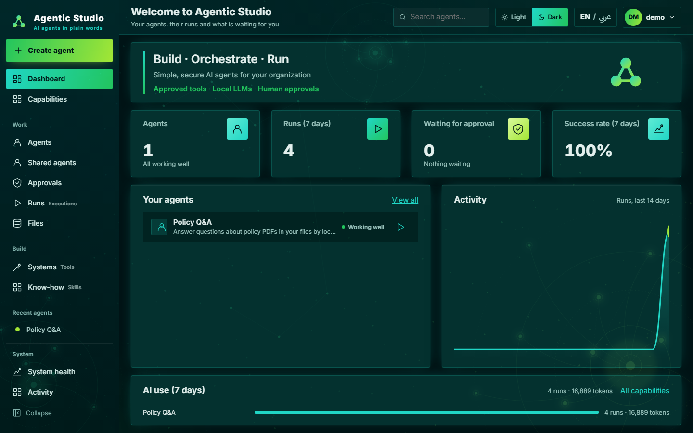

</div>

---

## Why it exists

Most agent platforms hand you a canvas of nodes, a list of API keys and a cloud account. That works for developers,
not for the operations engineer, analyst or HR officer who knows exactly what they need but should not have to wire
it. And organisations that keep their data on their own servers cannot use cloud agents at all.

Agentic Studio starts from the other end. A person says *"every weekday at 7, check the SQL servers and tell the ops
chat only if something is wrong"* and gets a working, tested agent. No canvas, no code. Behind that sentence the
studio picks the tools, **builds the missing ones itself**, applies your organisation's **skills**, assembles the agent from approved parts only, proves it
against the goal, and keeps watching it after it goes live. All of it on your own servers and your own models,
without internet access.

## What sets it apart

Popular agent platforms (n8n, Flowise, Dify, Langflow) are excellent builders: you design the agent yourself, on a
canvas or in a form. Agentic Studio is built on one of them (Langflow, unmodified) and adds the layer an organisation
needs to let *non-technical people* create agents safely, and to keep those agents working without supervision.

| | Typical agent builder, out of the box | Agentic Studio |
|---|---|---|
| **Creating an agent** | Drag nodes, write prompts, pick models and tools yourself | Describe it in English or Arabic; the studio plans, builds from approved parts, and proves it works before it can go live |
| **Missing integration** | Find a community node, or write the code yourself | **Sweeps your known systems** for their API descriptions and connects the operations your goal needs, or **writes the Python tool itself**, with a plain-words risk report and an administrator's approval |
| **Your way of working** | Paste guidance into each agent's prompt | **Skills**: know-how written once from plain words, approved and versioned, matched and applied to every fitting agent automatically |
| **Is the agent right?** | You test it by hand | Every build is **judged against the goal you stated**; facts beat the model (an agent that used no tool, or promised a file that never appeared, fails) |
| **After go-live** | Failed runs show up in a log | **Self-healing**: retry with the failure reason, goal re-check, backup model when a server is down, missed runs made up, chronic failures paused, owner told once |
| **Getting better** | Edit the prompt yourself | Corrections from users apply at once; misses become suggested fixes; agents keep notes between runs; regression test questions |
| **Changing real systems** | Optional confirmation nodes, if you add them | Changes always need a person's approval **on every call**, enforced by the definition, never by the model; secrets and IDs masked in every answer |
| **Where it runs** | Cloud-first, or self-hosted with internet | **Air-gapped by design**: offline bundle with checksums, no telemetry, own model servers, offline Python library kit for AI-written tools |
| **Who may do what** | Workspace roles | Directory or local accounts; user / builder / administrator; tools and know-how approved by administrators; full activity log |

## How it works

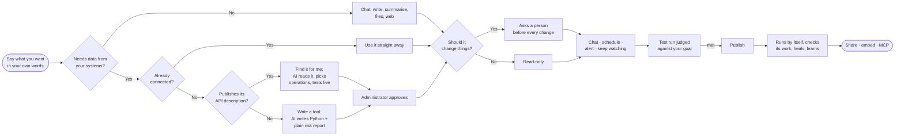

## Tools built on the fly

An agent is only as useful as what it can reach. When the designer finds an ability missing, it does not stop and
wait for a developer: it gets the tool, in one of three ways.

| Way | When | What happens | Safeguards |
|---|---|---|---|
| **Use what exists** | The system is already connected | The designer picks it | Reuse first: the same operation is never connected twice, under any host name |
| **Find it for me** | The system publishes OpenAPI or a contract file (`agent-studio.yaml` / `AGENT-STUDIO.md`) | The studio **sweeps the systems an administrator listed** for published descriptions, the AI pre-ticks the operations your goal needs, and the read operations are tested live | Administrator approval; no network scanning; changes are a separate ability behind approval |
| **Write a tool** | Nothing publishes it: mail, file shares, PDF, Excel, PowerShell, SSH, SNMP… | The AI writes a Python tool (one method per operation) and tries it in the engine on your real data | Plain-words **risk report**; administrator reads the code; every risky or changing operation asks a person **on every call**; each run in its own process with a time limit |

**Nothing is blocked; everything is visible.** AI-written tools may use any installed library: the safeguards are
people, not a sandbox that would block exactly the tools you need. Every tool can be **changed in plain words** (a new
version for approval) or removed, with the agents that use it named first. Air-gapped sites get an
[offline library kit](docs/REFERENCE.md#offline-libraries): nothing is ever downloaded on the server.

## Skills: your organisation's know-how

Tools are an agent's hands; a **skill** is how to do the job well. Every team has its own way: how an incident report
is laid out, which checks come first, what a good answer looks like. Skills capture that once and every matching agent
follows it.

- **Written from plain words.** Describe how the job is done; the AI turns it into a short card (when to use it,
  steps, answer format, the tools it needs, an example), using only what you said and only tools that exist.
- **Approved and versioned.** A skill is a draft until an administrator approves it; changes become new versions,
  earlier ones stay in history, and every decision lands in the activity log.
- **Applied without anyone asking.** While a person describes an agent, the designer matches approved skills to the
  request and applies them: the skill's steps go into the agent's instructions and its tools into its abilities.
  People never need to know skills exist; they just get agents that work the organisation's way.

| A tool written by AI: operations, risk, code, try it | A skill card written from plain words |
|---|---|
| 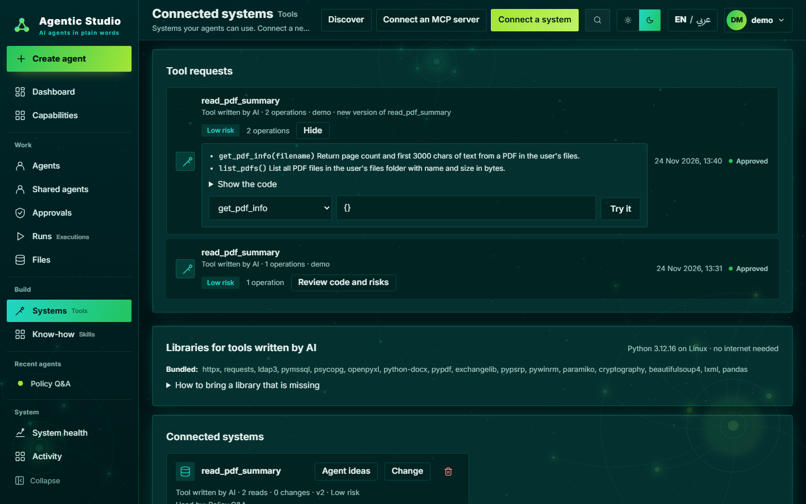 | 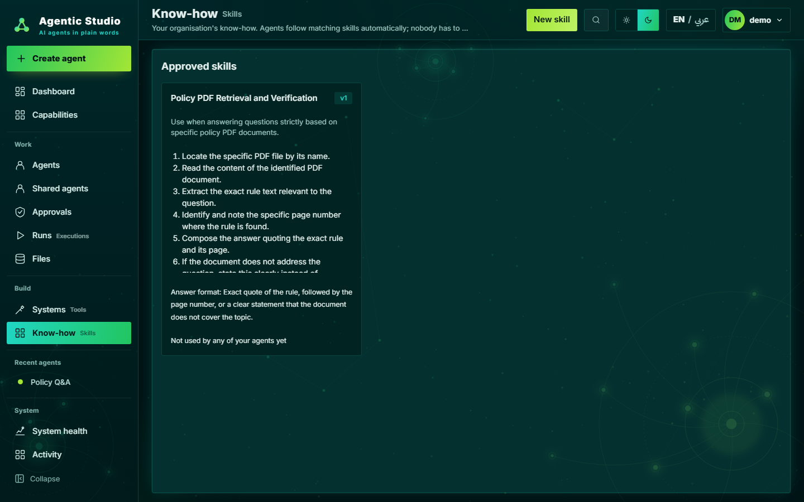 |

## Runs by itself and heals itself

Triggers: **chat** · **schedule** (any wording: *"every weekday at 7"*) · **alert** (a system calls a webhook) ·
**keep watching** (looks again every 15 minutes, remembers what it saw, acts only on what is new).

Small, deterministic *watchkeepers* keep live agents working:

- **Checks its own work.** Every run checks each goal against its tool results and tries once more another way.
- **Goal check on every run.** A miss is retried with exactly what was missing; a lasting miss becomes a suggested
  correction for the owner.
- **Retry with the reason.** A failed run is run again and told why, before anyone is alerted.
- **Backup model.** When the model server is down, live agents switch to the backup model and back when it returns.
- **Makes up missed runs** after an outage, and **pauses agents that keep failing**, telling the owner once.

**It learns.** *"Not right? Tell it how"* rewrites the agent's instructions at once; agents keep short notes between
runs; up to 10 test questions per agent catch regressions; a new skill version reaches agents when they are rebuilt.

**It works with others.** Agents ask other agents or hand a request over; share an agent with everyone or embed its
chat in a portal; every published agent is offered over **MCP**, and outside MCP servers can be connected.

| The agent, live and shared | People's own files for agents to read |
|---|---|
| 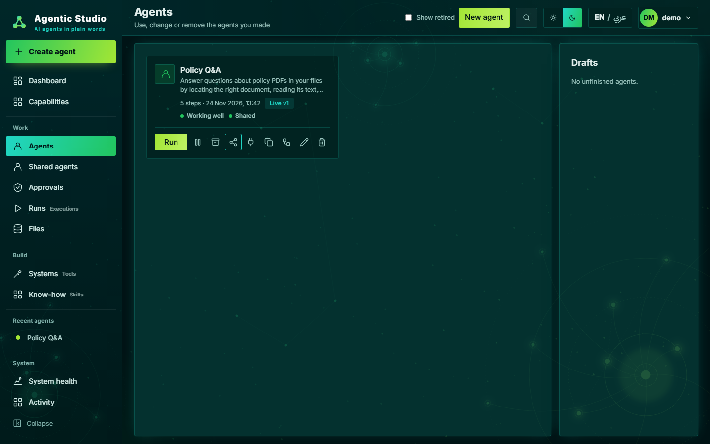 | 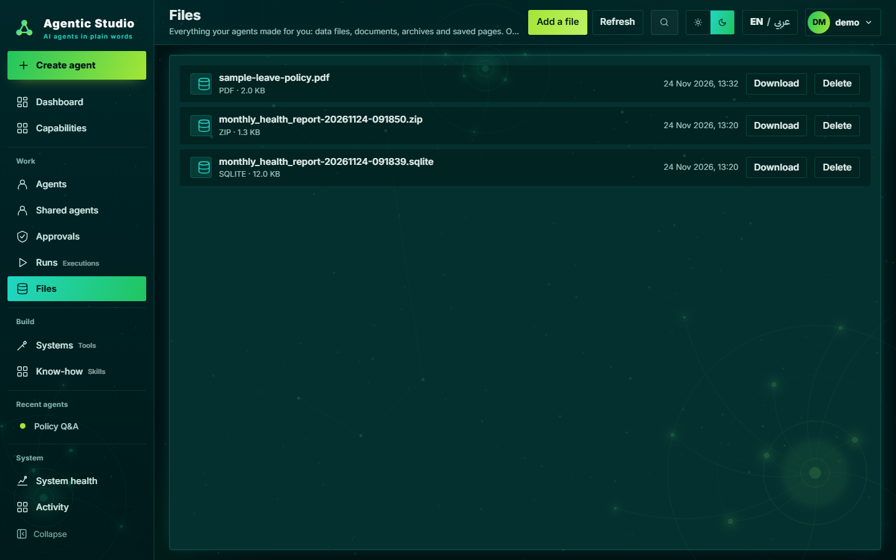 |

## Safety built in

| Concern | How it is handled |
|---|---|
| Changing systems | A human approval step in the agent; the run pauses on the **Approvals** page; set by the definition, never by the model |
| What agents may use | An approved component catalog, applied to the engine; every build is checked against it |
| Secrets in answers | Passwords, tokens, keys, credentials in URLs, ID and card numbers masked in every answer and notification |
| Sign-ins to systems | Typed on the Systems page, checked at once, kept encrypted; never in files or config |
| People | Local accounts (scrypt hashes) or directory (LDAP/AD) sign-in; roles `user` · `builder` · `admin` |
| Internet | Off by default; domain allow/deny lists; never internal addresses |
| Audit and air gap | Activity log (CSV export); no telemetry, no cloud calls, self-hosted fonts, strict content security policy |

## A tour: from words to a working agent

The showcase was built exactly this way: a **PDF reader tool written by AI** and a **Policy Q&A** agent that answers
from a sample policy document. Recreate it in minutes with [`examples/policy-qa`](examples/policy-qa).

1. **Describe it.** *"I want to ask questions about policy documents in my files. Find the right PDF, read it and
   answer from its text, quoting the rule you used."*
2. **The designer plans; code checks the plan.** The model can never add a tool, system or permission that is not in
   the registry. Watchkeepers look for duplicates, missing sign-ins and offline systems first.
3. **One card of choices**: read-only or with approval, when to notify, answer style (short, report, table, JSON),
   effort per run. A missing ability offers **Find it for me** or **Write a tool**.
4. **Built from approved parts, proved before publishing.** The agent runs once and is judged against your goal;
   publishing needs a passing proof.
5. **Live.** Publish, share, ask it. Every run is visible step by step.

| The designer: plan, choices, proof | Asking the agent |
|---|---|
| 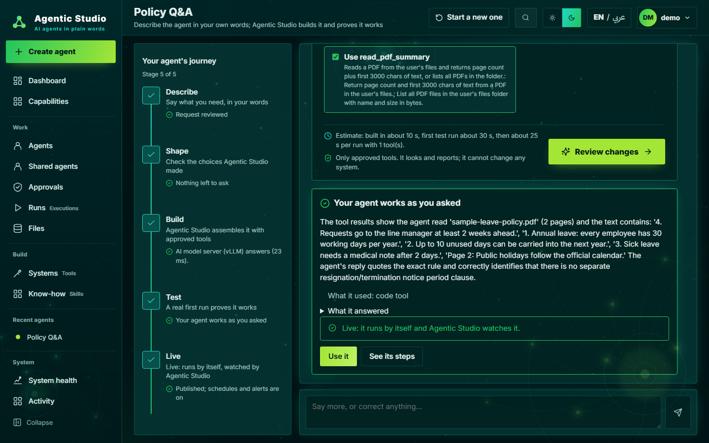 | 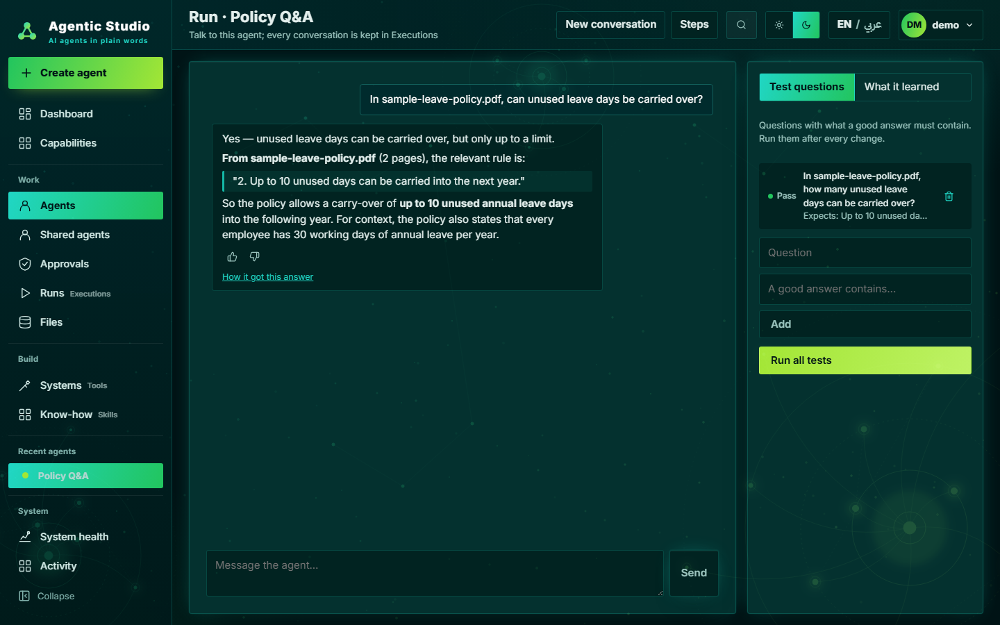 |
| **Every run, step by step** | **The capabilities map** |
| 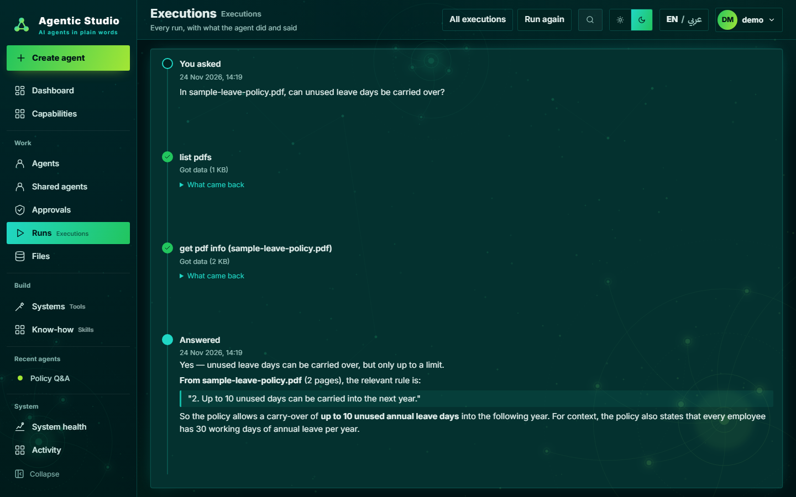 | 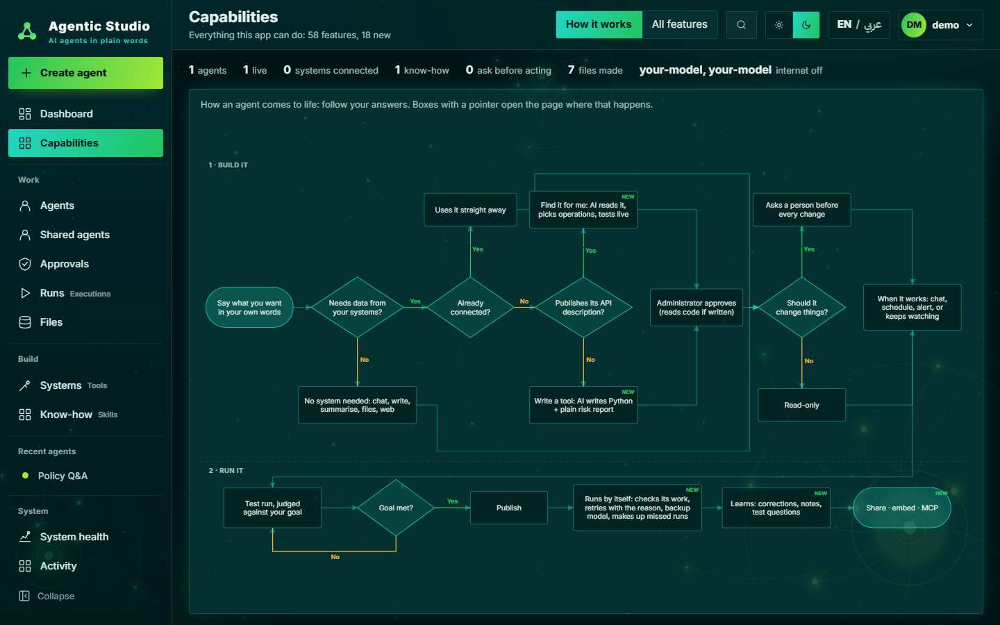 |

## Engineering highlights

- **Thin product over an unmodified engine.** One adapter module (`engine.py`) is the only code that knows the engine's
  API, guarded by a contract test; engine upgrades do not ripple through the product.
- **The model proposes, code decides.** Plans are validated against a registry; every claim about what you asked for
  must appear in your words.
- **Watchkeepers, not hope.** Deterministic checks before building and after go-live, with hysteresis and quiet
  periods so people are not spammed.
- **Safe AI-written code without a sandbox that blocks real work.** Static risk inspection, a timed trial run in its own
  process, human code review, per-call approval for changes.
- **One codebase, public and private.** Brand and every organisation value live outside the code; a release check and
  a pre-push hook prove no private detail ships.
- **Supply chain and air gap.** Hash-pinned lock file, checksum-verified engine source, offline image bundle with a
  manifest.
- **Tested end to end.** 113 tests drive the real stack (API, engine, models, browser click-throughs) plus 134 for the
  tool bundle. Every decision and its alternatives: [`UNDER_THE_HOOD.md`](UNDER_THE_HOOD.md).

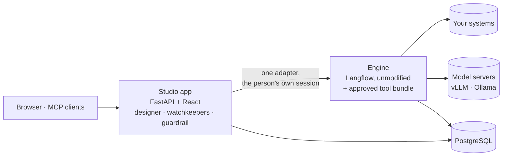

## Quick start

Any computer with [Docker](https://docs.docker.com/get-docker/) (Windows, macOS or Linux) and a model server it can
reach: [Ollama](https://ollama.com), vLLM, LM Studio, or any OpenAI-compatible API.

```bash
git clone https://github.com/soimthe1/agentic-studio.git && cd agentic-studio
docker compose -f docker-compose.quickstart.yaml up -d --build
```

1. First build takes 15-30 minutes (needs internet). Open **http://localhost:8095**.
2. Create the **administrator** on the first visit (no directory server needed).
3. **Settings → AI models**: type the server address (Ollama on the same computer:
   `http://host.docker.internal:11434`), press **Test**, choose a model, **Save**.
4. **Create agent** and describe what you want. Try the [Policy Q&A showcase](examples/policy-qa/README.md) first.

Everything is included (its own PostgreSQL, secrets generated on first start). Port taken? `STUDIO_PORT=9000`.
Ollama on Linux: start it with `OLLAMA_HOST=0.0.0.0`. Directory sign-in, production servers and offline bundles:
[FIRST_DEPLOYMENT.md](FIRST_DEPLOYMENT.md) and the [reference](docs/REFERENCE.md).

## Documents

- [`docs/REFERENCE.md`](docs/REFERENCE.md) - commands, configuration, services, build, deploy, API, layout, tests.
- [`UNDER_THE_HOOD.md`](UNDER_THE_HOOD.md) - every technique and decision: what, where, why, alternatives.
- [`FIRST_DEPLOYMENT.md`](FIRST_DEPLOYMENT.md) - one-time setup on a new server.

## License

Apache-2.0 (see [`LICENSE`](LICENSE)). The agent engine is [Langflow](https://github.com/langflow-ai/langflow) (MIT);
see [`NOTICE`](NOTICE).
